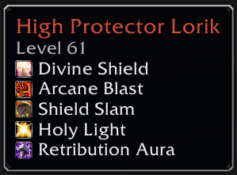
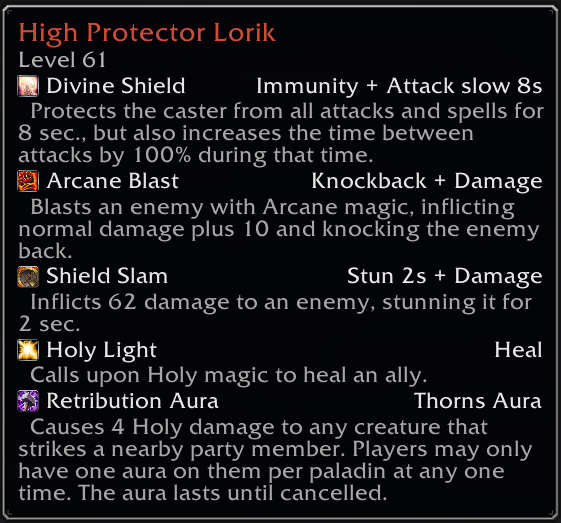
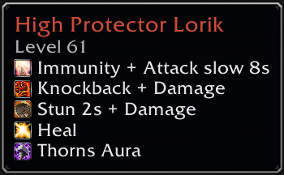
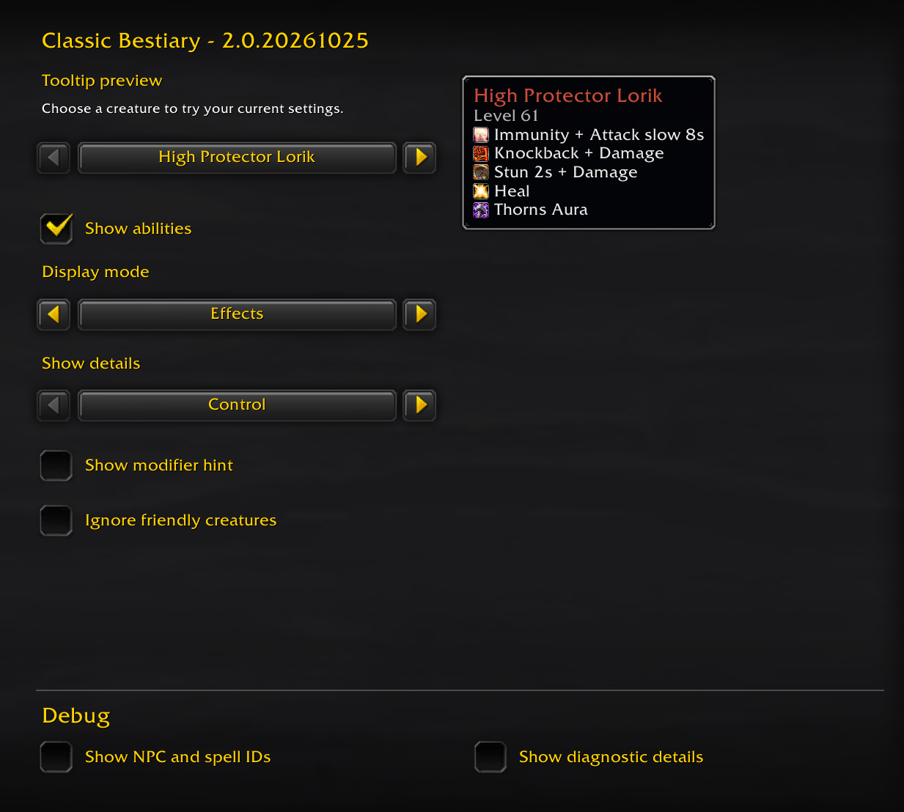

# Classic Bestiary

Shows creature abilities in tooltips for WoW Forever and Classic. Hover over a
creature to see its abilities, then hold **Control** for descriptions, effects and
related abilities.

## Install

Classic Bestiary can be downloaded and installed from:

- [CurseForge](https://www.curseforge.com/wow/addons/classicbestiary)
- [GitHub](https://github.com/Tibru-Tek-Addons/ClassicBestiary/releases/latest)

More locations coming soon.

## Screenshots

## Settings

Type **`/bestiary`** to open the Classic Bestiary settings panel.

Choose one of four display modes:

| Mode | Display |
| --- | --- |
| **Spells** | One spell name per row; the default. |
| **Spells (compact)** | Spell icons and names grouped inline. |
| **Effects** | Ability effects with spell icons. |
| **Effects (compact)** | Effect summaries grouped inline. |

Expanded details are the same in every mode. You can change the details modifier
key, show details always or never, hide friendly creatures, or turn tooltip
information off.

The panel includes a preview with several example creatures. Change the example
or hold your details key to see how the display will look. Your preview creature
choice resets when the UI reloads; your saved display settings do not.

**`/bestiary reset`** restores the default addon settings.

## Reading ability information

- Effect summaries highlight capabilities such as stuns, interrupts, healing,
  immunities and damage. Related effects may appear together, for example
  **Snare + Attack slow 5s**.
- Expanded details show spell descriptions and related abilities beneath their
  parent. A triggered effect is not necessarily a separate attack the creature casts.
- Durations apply to the effect beside them. Longer times use minutes and seconds,
  such as **1m 40s** or **30m**.
- A neutral stat label such as **Armor** or **Attack speed** does not necessarily
  mean an increase or a beneficial effect.
- A **?** beside an expanded description marks an unverified ability variant.
  When several variants share a name, the displayed choice is a best-fit estimate,
  not confirmation of the exact rank or spell used by that creature.

## Coverage and limitations

Ability information is static. The addon does **not** track casts, predict a
creature's next move, or guarantee every ability it can use. A missing ability
list does not mean the creature has no abilities.

On **WoW Forever**, creature ability tooltips are unavailable in most
instances due to Blizzard’s addon API restrictions.

Forever and Classic have separate ability information. The Classic dataset is
**best-effort**: some associations may not match your Classic version or season.
An ability's presence, range, effect or duration is not a guarantee of its actual
behavior in an encounter.

## Troubleshooting

In settings, **Debug** offers two optional displays:

- **Show NPC and spell IDs** helps identify the creature and abilities shown.
- **Show diagnostic details** reveals additional warnings about unavailable spell
  descriptions, uncertain variants and incomplete information.

These displays are off by default. If a description is temporarily unavailable,
allow the game time to load it. To restore the normal display, disable the Debug
options or use `/bestiary reset`.
